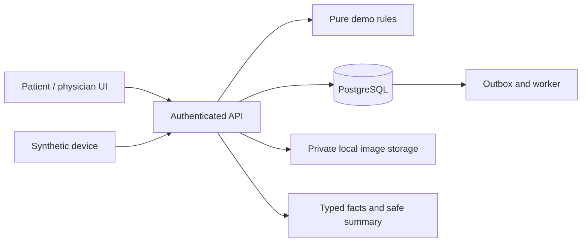

# RPM Platform

> **Demo with synthetic data. Not for medical use.**

RPM Platform is an educational research prototype for exploring diabetes and hypertension
monitoring with synthetic data. Patients can record readings and submit meal photos; authorized
physicians can inspect readings, review synthetic alerts and comment on meal photos. It is not an
emergency service, does not provide real-time supervision, and has not been clinically validated.
No clinician has approved its demo rule fixtures.

## What it contains

- Patient and physician interfaces, synthetic observations, append-only corrections, and
  deterministic demo alert rules with persistent notification outbox/retry state.
- Patient meal-photo submission and authorized physician comments. There is no food recognition,
  portion estimation or nutrient calculation in the selected workflow.
- Source-linked descriptive summaries rendered deterministically for patients; optional AI is
  isolated, and `AI_PROVIDER=fake` is the default.
- Synthetic device ingestion and a limited read-only FHIR R4 export. These are not evidence of
  real hardware accuracy or interoperability certification.

Observations, alert decisions, audit records and outbox events share a database transaction.
Relationship and purpose-specific consent checks govern physician access; admin roles have no
clinical reads. Observations are immutable and corrections append records. See
[architecture](docs/architecture.md), [safety case](docs/safety-case.md), and
[threat model](docs/threat-model.md) for the controls and gaps.

## Local quick start (PowerShell)

Prerequisites: Docker Desktop with Compose, Python 3.12 and `uv`, Node.js 24 and npm. This is a
local development setup with synthetic data only; **do not expose these services publicly**.
Startup time depends on installed tools, downloads and hardware; a ten-minute setup has not been
independently verified.

1. From the repository root, create the local configuration: `Copy-Item .env.example .env`.
   The example contains development-only values. Never put real credentials or patient data in it.
2. Install dependencies: `uv sync --project backend --locked --all-extras` and
   `npm --prefix frontend ci`.
3. Start the local stack: `docker compose up --build`.
4. In another terminal, apply migrations only to the disposable synthetic development database:
   `docker compose exec backend uv run --no-dev alembic -c alembic.ini upgrade head`.
5. Open [http://localhost:3000](http://localhost:3000). Choose **Explore as a patient**, use fictional details and a password of at least 12 characters, then enter the
   patient demo. Physician accounts require trusted provisioning and MFA; self-onboarding is not
   complete. See [the demo script](docs/demo-script.md). There are no published demo credentials.

The development stack binds published ports to localhost and uses development-only configuration. Candidate
multi-stage Dockerfiles are not an approved public deployment. See
[release readiness](docs/deployment-readiness.md) before considering any hosting. Do not run a
reset against any database or object store containing non-demo data.

## Evaluation evidence

| Evaluation | Local synthetic result | Scope |
| --- | --- | --- |
| Meal-photo checks | 7 unit checks passed | Image validation, comment validation and storage failure; no evaluation of comment quality |
| Summary checks | 0 detected findings in 200 summaries | Simple deterministic AI-off templates, lexical checks |
| Adversarial regression cases | 50/50 passed | Untrusted text excluded from deterministic path; no live model tested |
| Alert examples | 12/12 fixture-labelled examples matched | Small synthetic set, not independent clinical ground truth |
| Local load run | 1,000 submissions, 0 HTTP failures; p95 95.61 ms | One local synthetic run, not a capacity or clinical claim |
| Usability and clinician/faculty review | Pending | No participants, review or approval recorded |

Methods, denominators and limitations are in the [evaluation report](docs/eval/report.md) and
[performance record](docs/eval/performance.md). Regenerate the report with
`uv run --project backend python backend/eval/report.py`. See [progress](docs/PROGRESS.md) for exact
check results and remaining release-gate, coverage, mutmut and frontend-build debt. Screenshots or
video have not yet been recorded.

## Next steps

Run the [human evaluation protocol](docs/eval/human-protocol.md), close the public-demo safety and
verification gaps in [release readiness](docs/deployment-readiness.md), and only then consider an
authorized synthetic deployment. Clinical thresholds remain unreviewed and require clinician
approval; no real-patient or regulatory-compliance claims are made. See [contribution guidance](CONTRIBUTING.md).

## License

[MIT License](LICENSE). Third-party dependencies retain their own terms.
